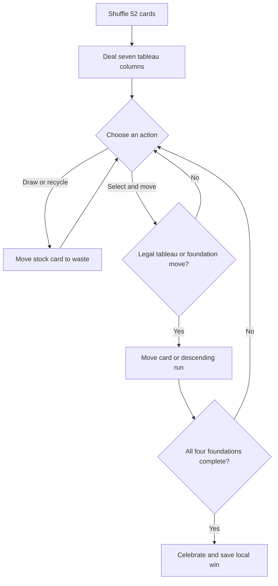

# Night Tableau

Night Tableau is a calm, responsive take on classic Klondike solitaire, built with Vue 3, TypeScript, and Vite. It runs entirely in the browser; personal win totals are saved locally.

**Play:** [oscarmmi.github.io/solitaire](https://oscarmmi.github.io/solitaire/)

## How to play

- Move face-up cards onto tableau columns in descending rank and alternating color. Move a face-up run by selecting any card in that run.
- Only a King can start an empty tableau column.
- Build each foundation from Ace to King, matching suit. Double-click a card or press Enter to send it to a legal foundation.
- Draw one card at a time from the stock. When it is empty, select it again to recycle the waste.
- Complete all four foundations to win.

Keyboard: use the arrow keys to highlight piles, Enter to select or move, **S** to draw/recycle, **R** for a new deal, and Escape to clear a selection. All controls also work with mouse and touch.

## Run locally

```sh
npm install
npm run dev
```

Run the pure game-rule tests and production build with:

```sh
npm test
npm run build
```

## Game loop



## Built with

Vue 3 · TypeScript · Vite · Vitest
